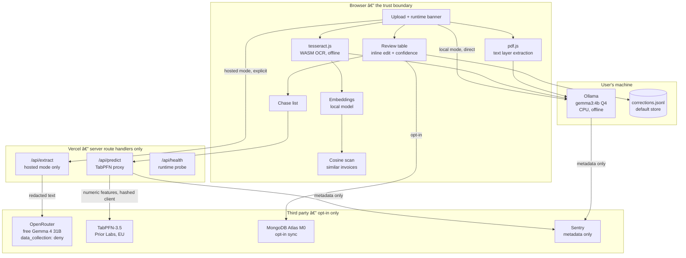
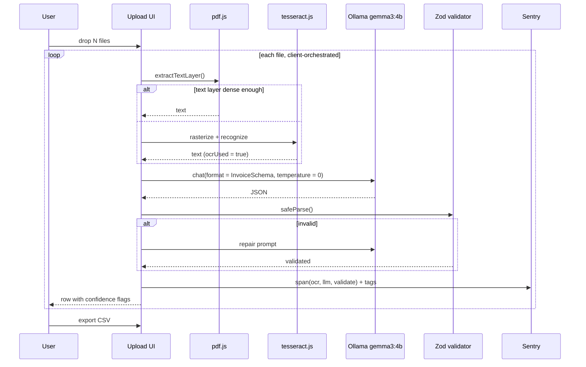

# Ledger — Architecture

## 1. System diagram



Two things matter about this diagram:

1. **In local mode the browser talks to Ollama directly.** The request never
   touches Vercel. There is no server-side component to log it.
2. **Every external dependency sits behind an explicit user action**, and the
   UI states what will leave the machine before it happens.

### The hosted path is a router, not a provider

The hosted arm calls OpenRouter, which is itself a gateway in front of Google's
inference. Two request fields make the privacy property a technical guarantee
rather than a promise:

```jsonc
{
  "model": "google/gemma-4-31b-it:free",
  "provider": {
    "data_collection": "deny"   // ineligible to route to a logging provider
  },
  "require_parameters": true,   // only endpoints honouring response_format
  "response_format": { "type": "json_schema", "json_schema": { ... } }
}
```

If no compliant endpoint is available the request **fails**. It does not
silently degrade. That is deliberate: a privacy control that degrades quietly
is not a privacy control. See `PRIVACY.md` §3.2.

## 2. Per-document sequence



Batches are driven by the client, one document per request. This is forced by
Vercel Hobby's 300-second function ceiling, and it happens to be the better
design anyway: no request is long enough to time out, and the progress queue
shows honest per-document state.

## 3. Runtime detection

On load the app calls `/api/health`, which reports which paths are live. Four
states, in descending order of preference:

| State | Condition | UI |
|---|---|---|
| `local` | Ollama reachable at `127.0.0.1:11434` | Green banner: "Local runtime · gemma3:4b · on this machine · nothing leaves your device" |
| `hosted` | Local unavailable, hosted key configured, quota remaining | Amber banner naming the provider and the `data_collection: "deny"` routing rule. User must confirm once per session before the first document |
| `demo` | Neither available | Pre-computed fixture results, instant, labelled as demo data |
| `blocked` | Hosted key present but daily quota exhausted or upstream 429 | Explicit message with retry-after, plus the demo path |

`/api/health` should also return the hosted provider's **remaining daily
requests**, so the UI can warn before a judge starts a batch rather than
failing mid-batch.

The banner must never claim a path that will fail. A judge seeing "local
runtime detected" on a machine with no Ollama would be far worse than being
told plainly that they need to pull a model.

### Hosted quota is shared

The hosted path consumes the operator's OpenRouter daily allowance, not the
user's. A busy demo can exhaust it. Two consequences:

- `/api/extract` returns a clear, non-retryable `429` to the client when the
  account quota is spent, with the reset time.
- A simple server-side day-counter (a single JSON file in the deployment, or
  an Upstash-style KV if one is available) lets the UI show remaining budget.
  Keep it deliberately simple — this is not worth an infrastructure dependency
  inside a 30-hour window.

### Client names are redacted before the hosted call

Before text is sent to any external provider, a regex pass strips anything
resembling an organisation name near "invoice from", "bill to", "sold by",
plus long digit runs resembling account or IBAN numbers. This is best-effort
obfuscation, not anonymisation, and the UI says so. It is a second layer
beneath the routing guarantee, not a replacement for it.

## 4. Browser -> Ollama

**`OLLAMA_ORIGINS` is read by the Ollama process on the user's own machine, at
its own startup. It is not an application variable, and setting it in Vercel has
no effect on anything** - the browser talks to that process directly, so the
request never reaches Vercel in the first place.

List every origin the app is served from. On Windows:

```powershell
[Environment]::SetEnvironmentVariable(
  "OLLAMA_ORIGINS",
  "http://localhost:3000,https://ledger-room-indigo.vercel.app",
  "User")
```

Then restart Ollama. It reads the variable once, at startup.

Two things that cost real time during WS1, recorded so they are not paid twice:

- **The failure mode is deliberately ambiguous.** An unlisted origin gets a 403
  with no `Access-Control-Allow-Origin`, which the browser reports only as "CORS
  blocked" - visually identical to Ollama not running, and not something the user
  can distinguish from the console. The app therefore reports *why* it concluded
  there is no runtime, and prints the exact command for the origin the user is
  actually on. Turning "it doesn't work" into a copy-pasteable fix is worth more
  than any amount of retry logic.
- **The request must stay a CORS _simple_ request.** Any header the browser does
  not consider safelisted forces a preflight, and Ollama's preflight allowlist
  is fixed - it permits `content-type` and rejects the rest. A Sentry
  `tracePropagationTargets` rule pointed at `localhost` injected a
  `sentry-trace` header into every request to `127.0.0.1`, which broke the
  runtime probe and made the app report "no local runtime" on machines that had
  one. The fix belongs at the source of the header, not in a proxy layered over
  the symptom. The deployed app also reached `http://127.0.0.1:11434` over HTTPS
  without a mixed-content block, as predicted below.
## 5. TabPFN integration

The contract is upload-by-signed-URL, not a JSON post of the data. The first
draft of this document had three routes and was wrong; the real flow is below,
verified against the live API.

```
POST /tabpfn/prepare_train_set_upload  -> signed URLs + train_set_upload_id
PUT  <signed url>                       -> x_train.csv   (features)
PUT  <signed url>                       -> y_train.csv   (target)
POST /tabpfn/fit                        -> fitted_train_set_id
                                            task_config: { task: "regression",
                                                           tabpfn_config: { model_path: "v3.5_default" } }
POST /tabpfn/prepare_test_set_upload    -> signed URLs + test_set_upload_id
PUT  <signed url>                       -> x_test.csv
POST /tabpfn/predict                    -> quantiles
                                            predict_params: { output_type: "quantiles",
                                                              quantiles: [0.1, 0.5, 0.9] }
```

Base URL `https://api.priorlabs.ai`, `Authorization: Bearer <key>`. Called from
a server route handler so `TABPFN_API_KEY` never enters the client bundle.
Before the call the raw client name is replaced with a stable hash — only
numeric features and a hash cross the boundary.

### Three things the API does that will bite if unhandled

1. **Fits over ~2s stream keepalive whitespace** before the JSON body. Reading
   the body whole and parsing tolerates this; expecting a clean parse on the
   first chunk does not.

2. **`header=infer` is applied server-side.** A CSV with no header row has its
   first *data* row promoted to column names, so the training matrix and the
   test matrix acquire different headers and the fit is rejected at predict time
   with `transform got different columns than fit_transform`. Both uploads
   therefore carry an identical synthetic header (`f0..f11`).

3. **The quantile response is transposed.** `prediction` is one array *per
   quantile*, each of length = row count — not one array per row. Read naively
   it yields `n_quantiles` predictions for `n_rows` rows, and interval coverage
   computes as a meaningless 100%. `metadata.test_set_num_rows` is the
   authoritative row count; see `normaliseQuantiles` in `lib/tabpfn.ts`.

Naive baselines are computed alongside every prediction and returned with it.
A prediction the user cannot compare against a trivial baseline is not
trustworthy.

## 6. Module layout

```
src/
  app/
    page.tsx                    upload, runtime banner, batch queue
    review/page.tsx             editable results table
    chase/page.tsx              payment prediction
    api/
      health/route.ts           runtime detection + hosted quota
      extract/route.ts          hosted path only, proxied to OpenRouter
      predict/route.ts          TabPFN proxy
  lib/
    schema.ts                   Zod Invoice + lineItem schemas
    redact.ts                  best-effort client-name / account-number scrub
    ollama.ts                  structured-output client (local)
    openrouter.ts              structured-output client (hosted, deny routing)
    ocr.ts                      pdf.js text layer + tesseract fallback
    confidence.ts               per-field heuristics
    tabpfn.ts                   upload -> fit -> predict
    features.ts                 history CSV -> feature matrix + baselines
    score.ts                    pure scorer, shared by harness and app
    store.tsx                   client state, fields-only persistence
    csv.ts                      export + RFC 4180 reader
    demo-data.ts                GENERATED: recorded output of the local run
    pipeline.ts                 ingest -> extract -> validate -> confidence
    ingest.ts                   pdf.js text layer + tesseract OCR fallback
  components/
    runtime-provider.tsx        the local -> hosted -> demo -> blocked ladder
    runtime-banner.tsx          FR-13, never claims a path that will fail
    upload-dropzone.tsx         FR-1 drag-drop + per-document batch queue
    invoice-table.tsx           FR-6/7/8/9 editable table + export
    confidence-badge.tsx        review-priority score, labelled as such
    provenance-tag.tsx          which runtime, which read path
    chase-list.tsx              FR-10/11 predictions + baseline comparison
    app-shell.tsx               app chrome, nav, theme toggle
    ui/                         shadcn (Base UI variant)
scripts/
  gate.ts                       WS1: proves schema-constrained output works
  fixtures.data.ts              20 fixtures + authored ground truth
  gen-fixtures.ts               deterministic fixture + PDF + PNG generator
  raster.ts                     dependency-free bitmap font -> PNG
  pdf.ts                        hand-rolled text-layer and image-only PDF
  verify-ingest.ts              FR-2/FR-3 assertions, one per fixture
  eval.ts                       accuracy / latency / cost harness, cached
  chase-eval.ts                 TabPFN vs both naive baselines, hold-out
  export-results.ts             results.json -> EVAL.md + demo dataset
  contrast-fix.ts               DESIGN.md section 2 rules applied to primitives
fixtures/
  manifest.json                 index, mess attributes, acceptable answers
  invoices/*.pdf|txt|truth.json 20 documents + ground truth
  history/invoice-history.csv   14 months of synthetic payment history
results/
  eval-1b.json, eval-4b.json   raw measurements, committed
  tabpfn.json                   hold-out metrics against the baselines
```

Two deviations from the layout sketched above, both deliberate. The project is
root-`src`-less rather than `src/`-shaped, matching the scaffold it started
from. And `baselines.ts`, `similarity.ts` and `corrections.ts` do not exist as
separate modules: the baselines are a few lines inside `features.ts` where the
per-client statistics they need already live, the cosine scan was not needed
at 20 documents, and corrections live in `store.tsx` because that is where they
are written. Splitting a single function across three files would have been
organisation for its own sake.

## 7. Key design decisions

**Schema-constrained output.** The Zod schema is converted with
`z.toJSONSchema()` and passed as Ollama's `format`, with `temperature: 0` and
one repair round-trip. Prompt-and-hope JSON fails silently on exactly the
messy input this product exists to handle.

**Client-orchestrated batches.** Forced by the 300s function ceiling, and
better regardless: no timeout risk, and honest per-document progress.

**Demo dataset as a first-class path.** A judge with no Ollama still gets the
full review, correction and chase-list flow. Labelled honestly as pre-computed.

**Retention-free by default.** Uploaded documents are held in memory for the
duration of extraction and never written to disk or to any upload directory.
For a product whose pitch is privacy, retaining the documents would undercut
the entire argument.

**Confidence is computed, not model-reported.** A 4B model asked for its own
confidence produces a number with no calibration. The score blends schema
completeness, whether the value appears verbatim in the source text, and
cross-field arithmetic consistency (`subtotal + tax == total`). Presented in
the UI as a review-priority score, not a probability.

**Atlas sync is opt-in and field-only.** See `PRIVACY.md` §2. Storing extracted
fields is a legitimate product decision; storing the documents would not be.

## 8. Environment and secrets

| Variable | Scope | Purpose |
|---|---|---|
| `OLLAMA_ORIGINS` | user's OS, not the app | Allows the deployed origin to reach Ollama |
| `NEXT_PUBLIC_OLLAMA_URL` | client | `http://127.0.0.1:11434` — not a secret |
| `NEXT_PUBLIC_OLLAMA_MODEL` | client | `gemma3:4b` — not a secret |
| `OPENROUTER_API_KEY` | server | Hosted path. **Never `NEXT_PUBLIC_`** |
| `OPENROUTER_HOSTED_MODEL` | server | `google/gemma-4-31b-it:free` |
| `OPENROUTER_BASE_URL` | server | `https://openrouter.ai/api/v1` |
| `ENABLE_HOSTED_MODE` | server | Default `false` |
| `TABPFN_API_KEY` | server | Prior Labs. **Never `NEXT_PUBLIC_`** |
| `MONGODB_URI` | server | Atlas. **Never `NEXT_PUBLIC_`** |
| `MONGODB_DB` | server | `ledger` |
| `NEXT_PUBLIC_SENTRY_DSN` | client | Public ingest key; safe to expose |
| `SENTRY_AUTH_TOKEN` | build only | Source-map upload |

`GEMINI_API_KEY` was evaluated and removed — Google AI Studio's free tier
publishes *"Content used to improve our products — Yes"*. It remains cited in
`PRIVACY.md` §3.1 as the motivating example, but this project does not send
data there.

Verification step before submission: grep every build artifact for
`OPENROUTER_API_KEY`, `TABPFN_API_KEY` and `MONGODB_URI` values.
