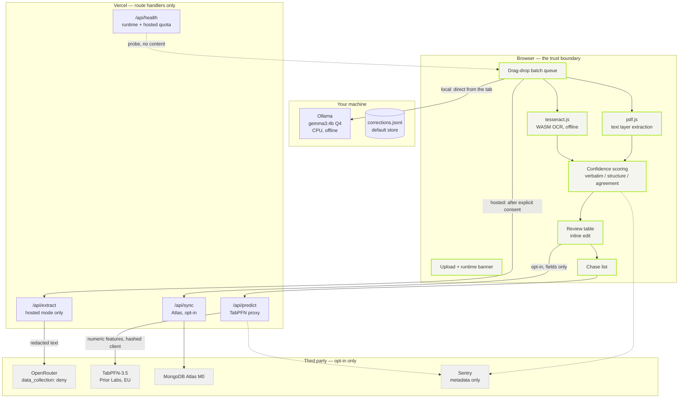
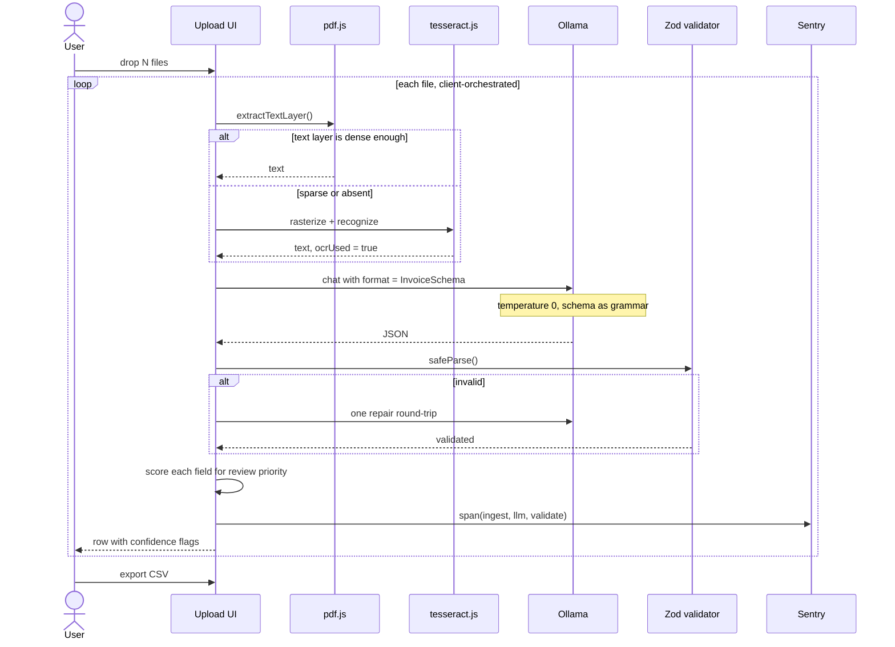
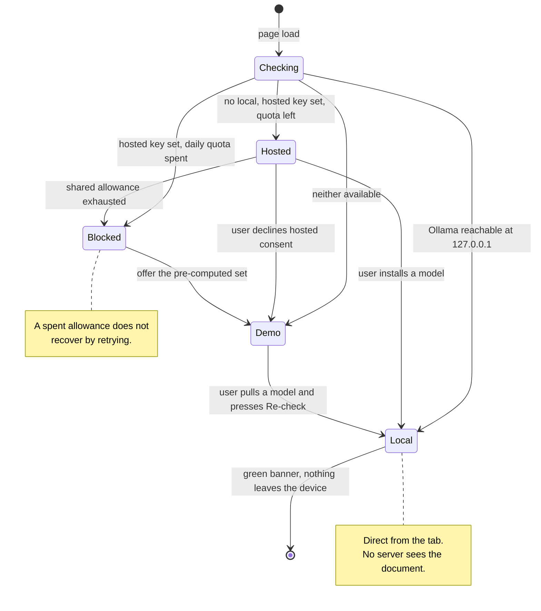
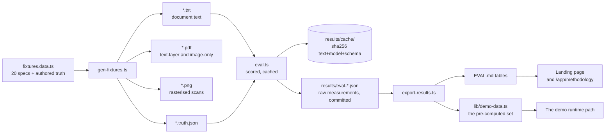
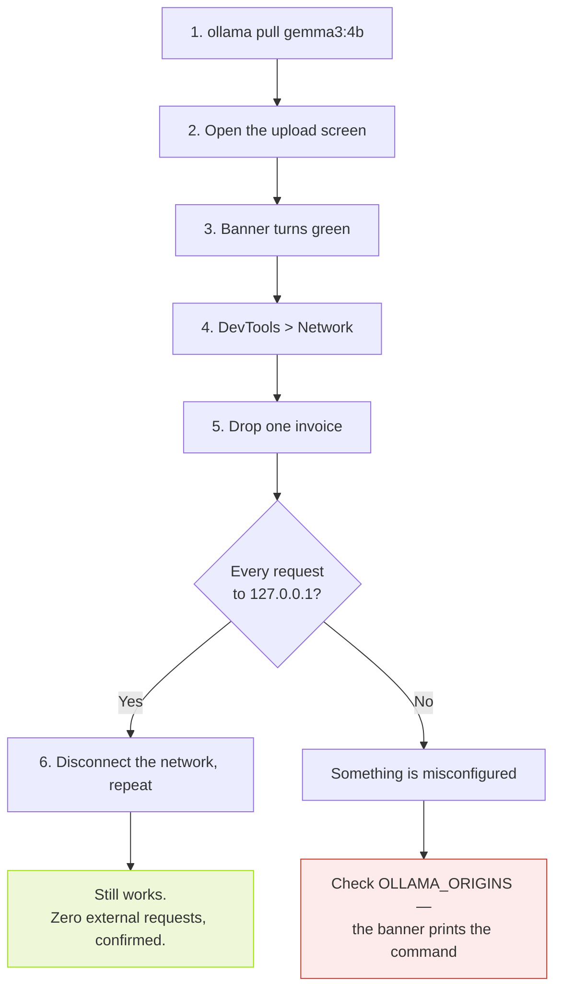

<div align="center">

# Ledger

**A local-first invoice and receipt sorter for freelancers, with a measured accuracy study of what the privacy costs.**

[](./LICENSE)
[](https://nextjs.org)
[](https://ollama.com)

[Live demo](https://ledger-room-indigo.vercel.app) · [Report an issue](https://github.com/Talha-Tahir2001/ledger-room/issues)

</div>

---

## The problem

A freelancer ends each month with 30–60 invoices and receipts in mixed formats — emailed PDFs, phone photos of paper receipts, screenshots of payment confirmations — and needs them as structured rows for an accountant or a tax filing.

There are two ways to get there, and one thing that looks like a third:

| Option | Cost | The catch |
|---|---|---|
| **Pay a bookkeeper** | $50–150/month | A stranger handles every client name, rate and account number you own |
| **Do it yourself** | 2–4 hours/month, forever | The same hours every month, re-reading documents whose content you already have |
| **Paste it into a hosted chatbot** | Free | Invoice text contains client names, project names, rates and bank details — and it goes to a service you don't control |

Ledger removes the third option's problem and most of the second option's cost.

---

## What it does

1. **Reads** PDF, JPG and PNG in the browser — the PDF text layer where one exists, tesseract.js OCR where it doesn't.
2. **Extracts** eleven typed fields with `gemma3:4b` running on your own CPU through Ollama, schema-constrained so output is valid by construction.
3. **Scores** each field for review priority using checks that can be verified, not model self-report.
4. **Exports** CSV and JSON, and captures every correction as a labelled training example.
5. **Predicts** which open invoices will be paid late, with an interval, scored against the naive baselines it has to beat.

> **No login. No API key. No upload.** Documents are processed in memory and never written to disk — there is no document store to breach because there is no document store.

---

## Measured results

Twenty synthetic invoices and receipts, hand-authored ground truth, run on an i7-1165G7 with **no GPU**.

| Metric | Value |
|---|---|
| Field accuracy | **66.2%** (n=19) |
| Exact-record accuracy | 5.3% |
| Line-item accuracy | 58.3% |
| Populated-field recall | 80.9% |
| p50 / p95 latency | 57.0s / 103.5s per document |
| Throughput | 60.7 documents/hour |
| Schema violations reaching the UI | **0** |
| **Cost per 20 invoices** | **$0.00** |

**Per-field, including where it fails:**

| Field | Accuracy | Field | Accuracy |
|---|---|---|---|
| tax | 100.0% | subtotal | 73.7% |
| vendor | 94.7% | invoiceNo | 68.4% |
| issueDate | 89.5% | billable | 47.4% |
| dueDate | 89.5% | **category** | **15.8%** |
| total | 84.2% | | |
| currency | 78.9% | | |

**Size curve, identical hardware:**

| Model | Params | Field accuracy | p50 | Populated recall |
|---|---|---|---|---|
| `gemma3:1b` | 1B | 59.4% | 37.7s | **96.2%** |
| `gemma3:4b` | 4B | **66.2%** | 57.0s | 80.9% |

The 1B model fills in *more* fields and gets *more of what it fills in wrong*. For an unattended pipeline that is the dangerous combination.

**Payment prediction, held out:**

| Predictor | MAE (days) |
|---|---|
| TabPFN-3.5 | **7.91** |
| Baseline: that client's historical mean | 8.12 |
| Baseline: global mean | 13.48 |

TabPFN wins by **2.6%** — a real margin, and a narrow one, because *who pays late is mostly a property of who the client is*.

Full tables, methodology and known gaps: [`EVAL.md`](./EVAL.md)

---

## Quick start

```bash
npm install
cp .env.example .env       # no keys required for the local path
npm run dev
```

Open <http://localhost:3000>. Without a model the app offers a pre-computed dataset so the whole flow still works.

For live local extraction:

```bash
ollama pull gemma3:4b
```

### Allowing your browser's origin

`OLLAMA_ORIGINS` is read by the **Ollama process on your own machine**, at its own startup. It is not an application variable, and setting it in Vercel has no effect — the browser calls Ollama directly, so that request never reaches Vercel.

```powershell
[Environment]::SetEnvironmentVariable(
  "OLLAMA_ORIGINS",
  "http://localhost:3000,https://ledger-room-indigo.vercel.app",
  "User")
```

Then restart Ollama. It reads the variable once, at startup.

> **A CORS trap worth knowing.** The browser→Ollama request must stay a CORS *simple* request. Any header the browser does not consider safelisted forces a preflight, and Ollama's preflight allowlist is fixed — it permits `content-type` and rejects the rest. A Sentry `tracePropagationTargets` rule pointed at localhost was enough to break the runtime probe and make the app report "no local runtime" on machines that had one. If you see that error, the browser names the offending header; the fix is to stop sending it.

---

## Architecture

### System diagram

The browser is the trust boundary. Note that in local mode the extraction request never reaches the server, so there is no server-side component that could log it.



### Per-document sequence

Batches are driven by the client, one document at a time. That is forced by Vercel Hobby's 300-second function ceiling, and it turns out to be the better design regardless: no request is long enough to time out, and the progress queue shows honest per-document state.



### The runtime ladder

The one rule that outranks everything else: **the banner must never claim a path that will fail.**



### Where the accuracy study comes from

The app is not a nicer wrapper around a model call — it is the harness with a table bolted on. Anything the study reports about latency, OCR fallback or schema validity is a fact about the shipping code path.



---

## Privacy

| Data | Destination | When |
|---|---|---|
| Invoice image / PDF | **Nowhere** — memory only | Never persisted |
| Extracted text | **Nowhere** — Ollama, local | Stays on your machine |
| OCR output | **Nowhere** — in-browser | Never persisted |
| Corrections | `corrections.jsonl`, local | Default store |
| Corrections (if sync enabled) | MongoDB Atlas M0 | Explicit opt-in |
| TabPFN feature row | Prior Labs (EU) | Only on explicit "Predict" |
| Client identity | Hashed client-side | Raw name never sent |
| Sentry spans | Sentry | Metadata only — no text, names or amounts |
| Hosted-path request | OpenRouter → compliant endpoint | Explicit opt-in, redacted first |

### Verifying it yourself, in about a minute



### The hosted path, and its limits

The hosted path is a router, not a provider. Two request fields turn the privacy property into something the request enforces:

```jsonc
{
  "provider": { "data_collection": "deny" },  // never eligible to route to a logger
  "require_parameters": true                  // only endpoints honouring response_format
}
```

If no compliant endpoint exists the request **fails**. It does not degrade quietly — a privacy control that degrades quietly is not a privacy control.

**The honest limit:** this controls *which endpoints are eligible*, not what every intermediary does with the request. It is meaningfully better than an unconstrained hosted call and categorically different from the local path, and the product does not claim it is the same guarantee.

Full detail: [`PRIVACY.md`](./PRIVACY.md)

---

## Commands

### Running the app

```bash
npm run dev          # dev server
npm run build        # production build
npm start            # serve the production build
npm run typecheck    # tsc --noEmit
npm run lint         # eslint
```

### Reproducing every published number

```bash
npm run gate         # proves schema-constrained output works before anything else
npm run fixtures     # deterministic corpus: PDFs, PNGs, ground truth
npm run ingest:verify# asserts text-layer vs OCR routing, one per fixture
npm run eval -- --model gemma3:4b --out results/eval-4b.json
npm run eval -- --model gemma3:1b --out results/eval-1b.json
npm run history      # synthetic invoice history for the chase list
npm run chase:eval   # TabPFN vs both naive baselines, held out
npm run results:export   # regenerates EVAL.md tables and the demo dataset
```

The response cache is committed, so the eval reproduces in **8 seconds on a machine with no GPU, no Ollama and no hosted quota**. It says so rather than pretending to have run inference:

```
All 20 responses came from the committed cache — no model was run.
Delete results/cache/ or pass --no-cache to force a real run.
```

### Verification

```bash
npm run verify:secrets    # greps every build artifact for every secret in the environment
npm run verify:atlas      # confirms Atlas stores fields only, never documents
npm run chase:check       # fails loudly if the baselines silently degrade into each other
npm run eval:cache        # reports cache hit/miss per arm
npm run verify:deployed   # exercises the live predict route against live Prior Labs
```

---

## Repository layout

```
app/
  page.tsx                  landing page, renders the study from committed results
  app/                      the application: upload, review, chase, methodology, privacy
  api/
    health/route.ts         hosted quota + runtime config (the local probe runs in the browser)
    extract/route.ts        hosted path only, proxied to OpenRouter
    predict/route.ts        TabPFN proxy, plus the held-out evaluation
    sync/route.ts           opt-in Atlas sync, fire-and-forget
components/
  runtime-provider.tsx      the local -> hosted -> demo -> blocked ladder
  runtime-banner.tsx        names the active path; never claims one that will fail
  upload-dropzone.tsx       drag-drop, per-document queue with honest timings
  invoice-table.tsx         editable table, confidence flags, export
  confidence-badge.tsx      review-priority score, labelled as such
  provenance-tag.tsx        which runtime, which read path
  chase-list.tsx            predictions with intervals and baseline comparison
  landing/                  the twelve marketing sections, server-rendered
  ui/                       shadcn/ui (Base UI variant)
lib/
  schema.ts                 Zod Invoice schema + JSON Schema for the grammar constraint
  ingest.ts                 pdf.js text layer + tesseract OCR fallback
  ollama.ts                 structured-output client for the local path
  openrouter.ts             structured-output client with deny-routing (server only)
  tabpfn.ts                 upload-by-signed-URL -> fit -> predict
  features.ts               history CSV -> feature matrix + baselines
  confidence.ts             per-field review-priority heuristics
  redact.ts                 best-effort client-name / account-number scrub
  score.ts                  pure scorer, shared by harness and app
  csv.ts                    export + RFC 4180 reader
  store.tsx                 client state, fields-only persistence
  demo-data.ts              GENERATED — recorded output of the local run
scripts/
  gate.ts                   WS1: proves the whole approach before anything is built
  fixtures.data.ts          20 fixtures + hand-authored ground truth
  gen-fixtures.ts           deterministic PDF + PNG + truth generator
  raster.ts                 dependency-free bitmap font -> PNG
  pdf.ts                    hand-rolled text-layer and image-only PDF writer
  eval.ts                   accuracy / latency / cost harness, response-cached
  check-baselines.ts        guards against a degraded baseline
  verify-*.ts               ingest, secrets, atlas, deployed
fixtures/
  manifest.json             index, mess attributes, acceptable answers
  invoices/*.pdf|txt|truth.json
  history/invoice-history.csv
results/
  eval-1b.json, eval-4b.json, tabpfn.json    raw measurements, committed
  cache/                                    cached model responses
```

### Design notes worth knowing

Three decisions are load-bearing and not obvious from the code alone:

**Documents are never written to disk.** The file is read into memory, processed, and dropped. Extracted *fields* persist to `localStorage` so a page reload doesn't cost a re-run — which is why there's no "clear my uploads" button, because there was nothing to clear.

**Confidence is computed, not asked for.** Asking a 4B model to rate its own confidence produces a number with no calibration, and it is confidently wrong on exactly the fields that cost money.

**The demo dataset is real output.** `lib/demo-data.ts` is generated from `results/eval-4b.json`, so the demo path shows genuine model results including their mistakes — not something tidied up for presentation. The banner labels it "demo data" and never calls it inference.

---

## Routes

| Route | |
|---|---|
| `/` | Landing page, with the accuracy study rendered from committed results |
| `/app` | Upload, runtime banner, batch queue |
| `/app/review` | Editable results table, export, corrections, optional sync |
| `/app/chase` | Payment prediction against naive baselines |
| `/app/methodology` | The full study |
| `/app/privacy` | Data flow and a verification checklist |

---

## Configuration

Every variable is optional for the local path. See [`.env.example`](./.env.example).

| Variable | Scope | Purpose |
|---|---|---|
| `NEXT_PUBLIC_OLLAMA_URL` | client | `http://127.0.0.1:11434` — not a secret |
| `NEXT_PUBLIC_OLLAMA_MODEL` | client | `gemma3:4b` — not a secret |
| `OLLAMA_ORIGINS` | **your OS, not the app** | Read by the Ollama process at startup |
| `TABPFN_API_KEY` | server | Prior Labs. Never `NEXT_PUBLIC_` |
| `OPENROUTER_API_KEY` | server | Hosted path, off by default. Never `NEXT_PUBLIC_` |
| `ENABLE_HOSTED_MODE` | server | Default `false` |
| `MONGODB_URI` | server | Atlas, opt-in sync. Never `NEXT_PUBLIC_` |
| `NEXT_PUBLIC_SENTRY_DSN` | client | Public ingest key, safe to expose |

---

## Limitations

1. Local 4B extraction is materially behind a frontier model, and this project measures exactly how much less. It is a system that does the tedious part and tells you precisely which part to check — not an autopilot.
2. The hosted 31B comparison was **not run**, so the central local-versus-hosted accuracy claim is unmeasured. The table says so rather than being quietly omitted.
3. Ambiguous numeric dates (`03/04/26`) are a known failure mode.
4. Payment prediction needs history. Below roughly 20 invoices it is weak, and the UI says so rather than showing false precision.
5. The four image-only fixtures were scored from authored OCR-style text, so the headline numbers **exclude OCR error rate**. The OCR path itself is verified separately (`npm run ingest:verify`, 20/20).
6. Payment prediction is validated against synthetic history with known per-client habits. A baseline fitted on 67 synthetic rows is easier to beat than one fitted on 67 real rows.
7. Handwriting is out of scope.
8. The hosted path is capped at 50 requests/day and subject to upstream rate limiting. It is a demo path, not production infrastructure.
9. Redaction before an external call is best-effort obfuscation, not anonymisation.

---

## Documentation

| | |
|---|---|
| [`PRD.md`](./PRD.md) | Problem, persona, requirements |
| [`PLAN.md`](./PLAN.md) | Execution plan, schedule, risk register |
| [`ARCHITECTURE.md`](./ARCHITECTURE.md) | System design and per-document sequence |
| [`DESIGN.md`](./DESIGN.md) | Design system, locked |
| [`DECISIONS.md`](./DECISIONS.md) | 20 ADRs, including the ones that went the other way |
| [`EVAL.md`](./EVAL.md) | The accuracy study, methodology and gaps |
| [`PRIVACY.md`](./PRIVACY.md) | Data handling and the verification checklist |

---

## Attribution

Built with [Next.js](https://nextjs.org), [Tailwind CSS](https://tailwindcss.com), [shadcn/ui](https://ui.shadcn.com) (Base UI variant), [Ollama](https://ollama.com), Google's Gemma 3 weights, [Tesseract](https://github.com/tesseract-ocr/tesseract), [pdf.js](https://mozilla.github.io/pdf.js/), [TabPFN](https://priorlabs.ai) (Prior Labs), [MongoDB Atlas](https://www.mongodb.com/atlas) and [Sentry](https://sentry.io).

Every fixture is synthetic. **No real client invoice was ever committed to this repository or sent anywhere** — including to the hosted path, which redacts client names and account-number-like digit runs on-device before any external call.

MIT licensed — see [LICENSE](./LICENSE).